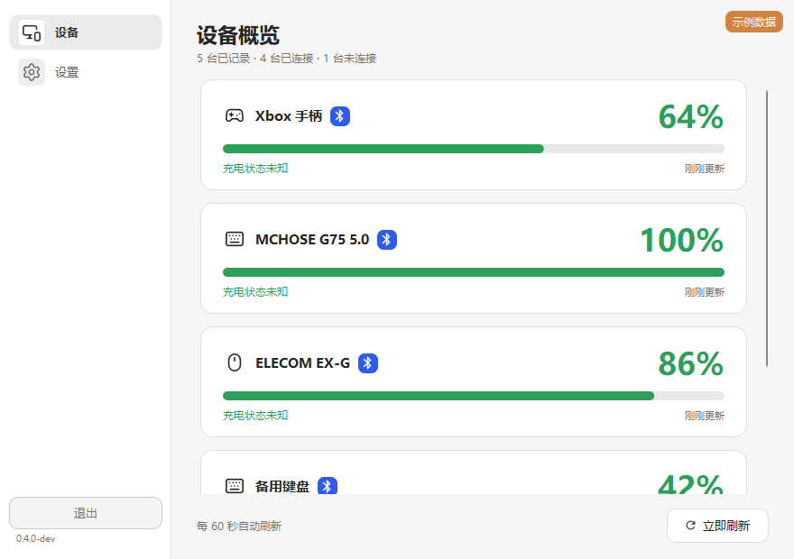
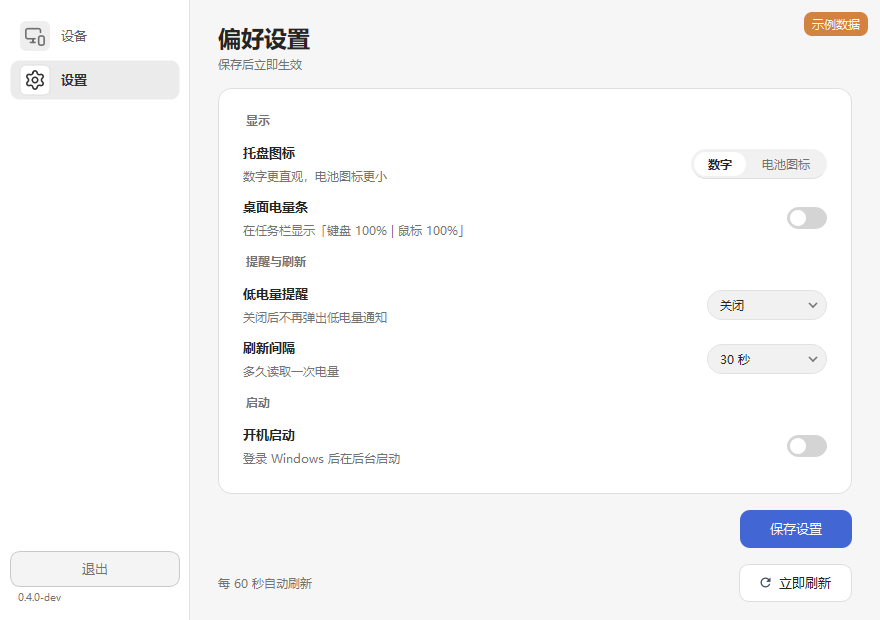
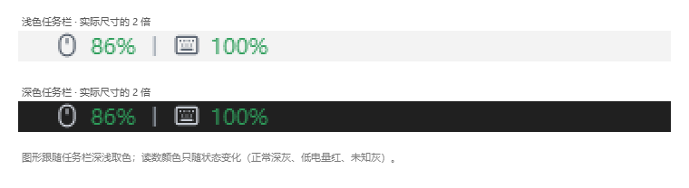

# KeyMouseBattery · 键鼠电量

在设备面板、系统托盘和桌面电量条中，随时查看无线键鼠的剩余电量。

KeyMouseBattery 是一款使用 Python / PySide6 开发的 Windows 电量工具。界面采用灰白配色，支持多设备记录、连接排序、低电量提醒与开机启动设置。

## 功能预览

### 设备电量一目了然

设备卡片展示类型、连接方式、电量百分比和进度条。新连接的设备自动移到顶部，断开的设备保留记录并显示“未连接”；电量变化和卡片排序采用平滑动效。

*界面演示使用五台模拟设备，包含键盘、鼠标和手柄；实际适配情况见下方设备表。*

### 按习惯调整设置

选择数字或电池样式的托盘图标，开启桌面电量条，调整刷新间隔和低电量提醒，也可以设置登录 Windows 后后台启动。

### 桌面上随时查看电量

透明电量条以鼠标、键盘图标配合百分比显示，支持拖动、置顶和位置记忆，点击即可打开设备面板。

*浅色与深色任务栏外观样张，按实际尺寸的 2 倍展示。*

## 适配设备

适配情况按型号与连接方式记录，以下为 `0.4.0-dev` 的范围。

| 设备 | 连接方式 | 状态 |
| --- | --- | --- |
| 迈从 MCHOSE G75 Pro（蓝牙名称 `MCHOSE G75 5.0`） | 蓝牙 | 已实测读取电量 |
| ELECOM `M-XGM15BBSWF/EC`（EX-G） | 蓝牙 | 已实测读取电量 |
| G75 Pro 相关接收器：`3554:FA07` / `3554:FA09` | USB 2.4G | 已实现读取路径，需通过接口与 ACK 型号校验；应答受固件和休眠状态影响 |
| 提供标准 GATT 电量服务 `0x180F` / 特征 `0x2A19` 的其他设备 | 蓝牙 | 可尝试使用，具体型号待实测 |
| 其他接收器、私有协议设备及 USB 有线模式 | USB | 待适配 |

蓝牙设备需要在 Windows 中完成配对并连接，且电量服务可读。接收器适配取决于具体型号及协议，相同 USB ID 的设备也需要型号校验。

## 使用方式

仓库当前提供源码，版本为 `0.4.0-dev`，尚未发布可下载的 Release。构建入口为 `build.ps1`；安装 `requirements.txt` 中的依赖后，可运行 `python KeyMouseBattery.pyw`；打包使用 `./build.ps1 -Python python`。依赖说明见 [CREDITS.md](CREDITS.md)。

已有便携构建包时：

1. 解压到可写文件夹，运行 `KeyMouseBattery.exe`。
2. 连接设备，在面板中查看电量；通过托盘图标打开面板或菜单。
3. 在“设置”中调整显示、提醒和启动选项，点击“保存设置”应用。

| 设置 | 可选项 / 行为 |
| --- | --- |
| 刷新间隔 | 30 / 60 / 120 / 300 秒，也可手动刷新 |
| 低电量提醒 | 关闭 / 10% / 20% / 30%；在线有效读数降至阈值时提醒 |
| 托盘图标 | 数字 / 电池图标 |
| 桌面电量条 | 默认关闭，开启后显示紧凑电量摘要 |
| 开机启动 | 在便携构建版中设置，登录 Windows 后后台启动 |

## 开发状态

当前版本的后续工作：

- 修复同类别 BLE 记录可能隐藏独立 USB 设备的问题。
- 当前蓝牙候选枚举上限为 64 台。
- 补充真实登录自启、高 DPI、多屏及任务栏深浅切换验证。

便携程序目前未签名，Windows SmartScreen 可能显示未知发布者提示。版本记录见 [UPLOAD_STATUS.md](UPLOAD_STATUS.md)。

## 读取方式

蓝牙通过标准 GATT 电量服务读取数据。G75 Pro 接收器路径使用 `0xFF02:0x0002` 接口与 report `0x13`，完成会话和型号校验后查询电量。

当前实现将 `1..100` 作为有效电量，其余返回值显示为“—”。蓝牙读取路径显示“充电状态未知”；接收器按协议提供的信息显示充电状态。

## 数据与卸载

配置、设备记录和日志保存在程序目录的 `data/` 中。开机启动使用当前用户的 `Run/KeyMouseBattery` 注册项。

卸载前在设置中关闭开机启动并保存，然后退出程序、删除程序文件夹即可。

## 许可与致谢

KeyMouseBattery 是独立维护的 Python / PySide6 项目，采用 MIT 许可证。第三方依赖、图标许可及早期协议参考资料见 [CREDITS.md](CREDITS.md)，版权与许可文本见 [LICENSE](LICENSE)。